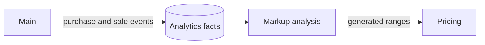

# Analytics Service

Analytics builds independent reporting facts from Main events and analyzes historical data for other services.

## What It Does

- synchronizes completed purchase and sale facts from Main;
- removes facts when their source operation is deleted or no longer completed;
- analyzes historical sale margins and generates markup ranges for Pricing;
- runs ABC/XYZ analysis of products and stores every result as a reusable analysis run.

## Data Flow

Markup analysis groups historical sales by purchase cost and publishes the mean markup for each range. Pricing consumes
these ranges as an auto-generated markup group. See [PRICING.md](PRICING.md).

## ABC/XYZ Analysis

ABC ranks products by revenue or quantity: class A forms the first `aShare` of the total, B the next `bShare`, C the
rest. XYZ measures demand stability as the coefficient of variation of monthly values: X up to `xCoefficient`, Y up to
`yCoefficient`, Z above. Products with fewer than `minPeriods` months of history since the first sale have no XYZ class.
Months are zero-filled from the first sale to the end of the window.

### Running

The analysis is a long-running task (`AbcXyzCalculationLrt`) started with `POST /jobs`. All parameters are passed in the
task input state; nothing is stored in settings and nothing has defaults.

| Field | Required | Meaning |
| --- | --- | --- |
| `from`, `to` | yes | First and last month of the window (first day of a month, UTC, `to` included) |
| `abcMetric`, `xyzMetric` | yes | `Revenue` or `Quantity` |
| `aShare`, `bShare` | yes | Cumulative shares of classes A and B, positive, sum not above 1 |
| `xCoefficient`, `yCoefficient` | yes | Class bounds, `0 < x < y` |
| `minPeriods` | yes | Minimum months of history for an XYZ class, at least 2 |
| `months` | no | Calendar months (1..12) to keep in every year, for seasons |
| `organizationId`, `buyerId` | no | Restrict the analysis to one organization or buyer |

### Reading Results

Every finished analysis is saved as a run (`analytics_runs`) with its items (`analytics_run_items`). A run exists only
after a successful calculation; job status and errors stay in the Jobs module (`jobId` links the two).

| Operation | Permission | Purpose |
| --- | --- | --- |
| GraphQL `analytics.runs(input)` | `CHARTS_GET` | Runs of all analysis types, newest first, cursor `(id, createdAt)`, filters by type, pinned flag and period |
| GraphQL `analytics.run(id)` | `CHARTS_GET` | One run: `parameters` and `summary` as JSON, `analysisType`, `schemaVersion` |
| GraphQL `analytics.charts` / `chart(...).data` | `CHARTS_GET` | Chart `AbcXyzRunItemsChartDataSource`: products of one run by rank, filters by ABC and XYZ class |
| GraphQL `analytics.setRunPinned(runId, isPinned)` | `ANALYTICS_RUNS_EDIT` | Pin or unpin a run |

`summary` of an ABC/XYZ run holds the 3x4 matrix: `cells` contain `abc`, `xyz` (`null` when the class is not defined),
`productsCount` and `value`. Product names are resolved by the frontend by `productId`.

### Retention

`RemoveOldAnalyticsRunsLrt` is scheduled monthly (`0 5 1 * *`, seeded by the migrator) with `olderThanDays = 90`. It
removes unpinned runs older than that together with their items. Pinned runs are never removed.

## Current Scope

The legacy product metrics implementation has been removed and will be replaced by the segmented analytics model.
Price forecasting, recommendations, and supplier price history remain roadmap items in [TODO.md](TODO.md).
