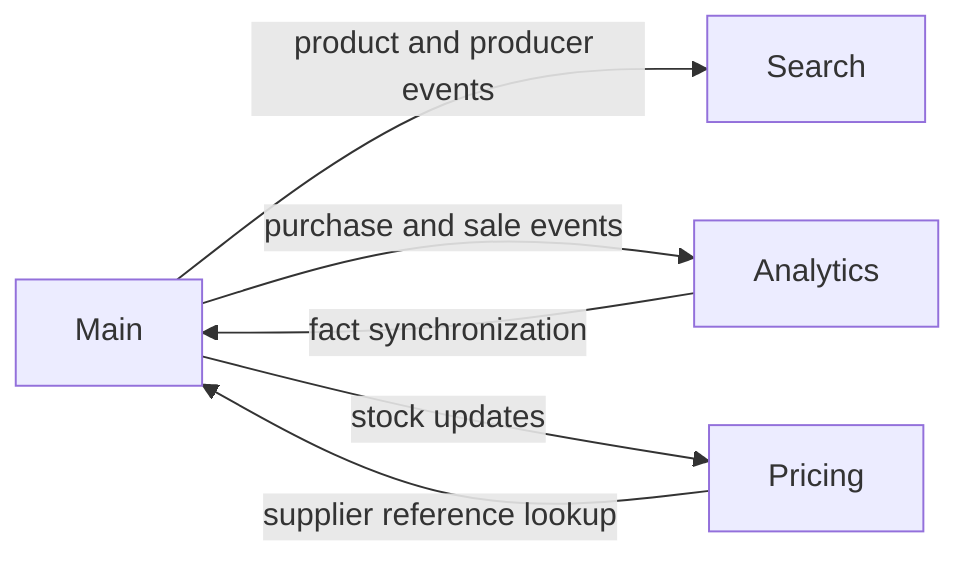

# Main Service

Main owns the core business data and operations. Warehouse functionality is described separately in [WMS.md](WMS.md).

## What It Does

- manages products, producers, aliases, characteristics, dimensions, weights, images, and product relations;
- maps supplier producer/SKU references to the internal catalog;
- handles users, authentication, roles, permissions, contacts, discounts, and financial profiles;
- processes carts, purchases, sales, balances, and transactions;
- manages currencies and exchange-rate history;
- stores uploads and product media in S3-compatible storage;
- runs CSV imports for products, producers, aliases, crosses, and supplier mappings;
- provides internal APIs used by Pricing, Search, and Analytics.

## Main Areas

The public API is GraphQL, composed through the gateway: catalog (products, producers, product media, sizes, weights,
characteristics, content, crosses), warehouses and stock lots, uploads, organizations, finances, transactions, sales,
purchases, users, roles, currencies, options, and Pricing.

REST endpoints remain for authentication, product image upload (multipart), and internal service calls:

| Prefix | Purpose |
| --- | --- |
| `/main/auth` | Registration, login, token refresh, password recovery, and email confirmation. |
| `/main/products/{id}/imgs` | Multipart upload of product images. Removal is available in GraphQL. |
| `/main/internal` | Internal endpoints for Pricing, Search, and Analytics (not exposed by the gateway). |

Exact schemas and permissions are available at <http://localhost:8080/docs>.

## Service Integration



Main publishes changes through RabbitMQ instead of sharing its database. Search updates indexes, Analytics synchronizes
facts, and Pricing rebuilds internal offers from these events.

## Background Work

Main Worker processes email and long-running jobs. Current import jobs accept CSV data for catalog and supplier mapping
operations, while currency-rate and catalog synchronization jobs support scheduled maintenance.

`ProductSynchronizationLrt` accepts an optional `parts` field. Omit it (send `{}`) to synchronize all sections, or send
`"All"`, `"Core"`, `"Characteristics"`, `"Dimensions"`, `"Weight"`, or a comma-separated combination such as
`"Characteristics, Weight"`. Numeric flag values are also accepted: Core = 1, Characteristics = 2, Dimensions = 4,
Weight = 8, All = 15. Combine numeric values with bitwise OR; zero and unsupported bits are rejected.

The job creation endpoint takes `inputState` as a JSON string:

```json
{
  "systemName": "ProductSynchronizationLrt",
  "inputState": "{\"parts\":\"Characteristics, Weight\"}",
  "maxAttempts": 3
}
```

In `/jobs/available`, `initStateSchema.fields` describes `parts` as an enum with the `EnumSelector` control and
`dependency.entityName = "ProductEventParts"`, plus a localized label and description. For multiple selections, join the
enum names with `", "` before serializing `inputState`; `parts` is a single string or number, not a JSON array.

See [TODO.md](TODO.md) for planned supplier-driven catalog enrichment and automatic suggestions.
